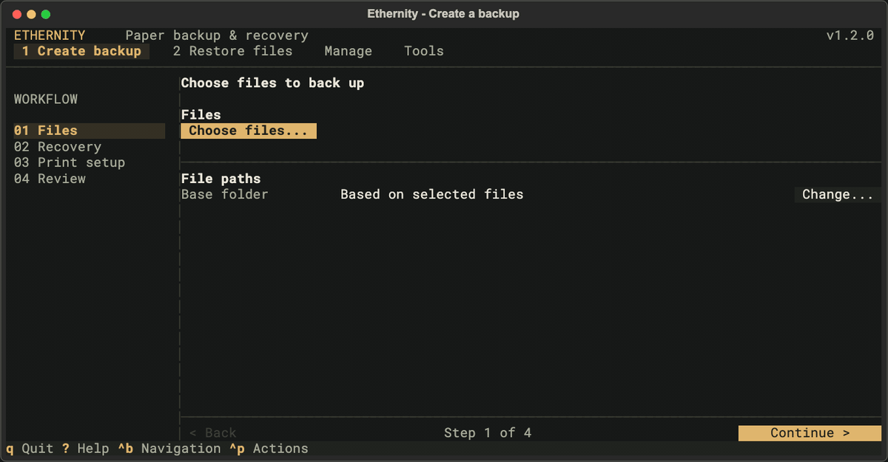

<p align="left">
  <a href="https://github.com/MinorGlitch/ethernity/actions/workflows/ci.yml">
    
  </a>
  <a href="https://pypi.org/project/ethernity-paper/">
    
  </a>
</p>

<p align="center">
  <a href="images/ethernity-logo.svg">
    
  </a>
</p>

Ethernity encrypts small files and turns them into PDFs you can print. Recover your files offline
from QR codes or printed text, using the terminal app, command line, or browser recovery kit.
No account or online service is required.

Use it for seed phrases, private keys, certificates, and configuration files.

<p align="center">
  <a href="images/readme/backup_flow.gif">
    
  </a>
</p>

A guided backup walkthrough with demonstration files and settings. Recovery is checked from the
generated PDFs; processing waits are shortened. Test your printed copies before storing them.
[View a static preview](images/readme/terminal_app_preview.png).

## What you keep

Ethernity creates two kinds of pages:

- **Backup pages** contain your encrypted files as QR codes and text.
- **Recovery sheets** hold pieces of the passphrase that unlocks those files. By default, Ethernity
  creates three sheets; any two can reconstruct the passphrase.

To restore, you need the backup pages and enough recovery sheets, or the passphrase itself.
Keep the recovery sheets in separate places, apart from the backup pages.

## How much fits on paper?

A recovery phrase or short note is usually well under 1 KB. A collection of keys, certificates,
or configuration files can take several pages. Photos and large archives quickly become
impractical to print and scan.

For a single file that does not shrink with compression, the default Sentinel design on A4 gives
these examples:

| File size | QR backup pages | Pages if you print the complete set |
| --- | --- | --- |
| 1 KB | 1 | 8 |
| 10 KB | 3 | 19 |
| 100 KB | 23 | 121 |

The complete set includes the text fallback, three recovery sheets, and an inventory. A printed
browser recovery kit is extra. Text often compresses well, so your files may need fewer pages;
the paper size and design also affect the count. The app estimates QR pages before you create
the backup and reports the total page count afterwards.

A standalone backup supports up to 2,048 files and 1 MiB of encrypted data, roughly 1 MB after
compression and encryption. That is a size ceiling, not a recommended amount to print.
See [capacity and page counts](https://github.com/MinorGlitch/ethernity/wiki/Capacity-and-page-counts)
for compression examples, other paper sizes, and how to check your own files.

## Install

The desktop app opens in your browser, with a menu-bar or notification-area icon for status and Quit.
The `ethernity` command opens in your terminal.
Both use the same interface and work offline. Packaged downloads include Python and everything
needed to create and restore backups.

This guide describes Ethernity 1.2. See the [release notes](docs/releases/1.2.0.md) for changes
and publication status, and [GitHub Releases](https://github.com/MinorGlitch/ethernity/releases)
for available downloads. For an older version, follow the README at its release tag.

| Platform | Installation | Start |
| --- | --- | --- |
| macOS, Apple silicon (desktop) | Open the release's `.dmg` and drag Ethernity to Applications | Open Ethernity |
| Windows x64 (desktop) | Run the release's `-setup.exe` | Open Ethernity from Start |
| macOS, Apple silicon | `brew install minorglitch/tap/ethernity` with [Homebrew](https://brew.sh/) | `ethernity` |
| Windows x64 | Download the release's `install.ps1`, then run `powershell -NoProfile -ExecutionPolicy Bypass -File .\install.ps1` | Open a new terminal, run `ethernity` |
| Linux x64 / ARM64 | Download the release's `install.sh`, then run `sh install.sh` | `ethernity` |

Run `ethernity --version` to check the installed version. Linux native builds require glibc 2.35
or newer; Ubuntu 22.04 is the tested minimum. WinGet support is being prepared and is not yet
available in the community repository.

Intel Mac users can use the [Python installation route](docs/install.md#python-users).
Starting with 1.2, we no longer build native Intel Mac archives or Homebrew bottles.

See the [installation guide](docs/install.md) for prerequisites, updates, uninstall, portable
downloads, verification, and Python installation with uv or pipx.

## Make a backup and try restoring it

Open the desktop app, or start it from a terminal:

```sh
ethernity
```

For the same interface in a browser, run `ethernity --web`. It runs on your computer and works
offline, using your usual settings and local files. Keep the launching terminal open; press
Ctrl+C there to stop it. This is separate from the standalone HTML recovery kit.

1. Choose **Backup** and add a test file.
2. Keep the default recovery setting: three sheets, any two needed.
3. Choose a paper size and destination, review the backup, and create it. Ethernity saves the PDFs
   in a new `backup-<id>` folder inside that destination.
4. Print the PDFs at actual size.
5. Choose **Restore**. Load scans of the backup pages and any two recovery sheets.
6. Restore to a new destination and compare the result with your test file.

While a task runs, the app shows its current stage, elapsed time, and file or PDF page counts.
Cancel waits for the current operation to stop and removes temporary output. Once the final save
begins, cancellation is disabled. A failed or cancelled task lets you return to your form choices.

Test the printed copies you plan to store. Keep another backup of important files.

For recovery in a browser, keep a copy of the
[offline recovery kit](docs/advanced_operations.md#create-a-reusable-offline-browser-recovery-kit).
The kit contains the recovery software, works across backups, and can also be printed.

## Update a backup

Choose **Manage > Add files** to add new files or replace existing ones without reprinting the
whole backup.

Updates are cumulative by default. To restore a version, keep the original backup, that update,
and your recovery sheets. Earlier updates are only needed if you want their earlier versions.

Incremental updates can reduce printing further, but recovery needs every update through the
version you want. Choose the mode when you start an update series.

Use **Rebuild backup** to make a new standalone backup from the current files. See
[updates and rebuilds](docs/advanced_operations.md) for examples and recovery requirements.

## Use from a script

`ethernity run` provides the same operations as commands. For example, back up a folder:

```sh
ethernity run backup --input ./documents --output-dir ./paper-backup --yes
```

This creates `./paper-backup/backup-<id>/` with the backup documents and default recovery sheets.
The destination is always a parent folder; Ethernity creates it if needed. Without `--output-dir`,
the parent is the current folder. Replace `--yes` with `--preview` to check the operation without
creating files.

Run `ethernity run --help` to list commands, or `ethernity run restore --help` for restore options.

## Documentation and development

- [Security](SECURITY.md): what Ethernity protects against and how to report a vulnerability.
- [Format specification](docs/format.md) and [design rationale](docs/format_rationale.md).
- [Update format and recovery rules](docs/extension_publication_rules.md).
- [Format compatibility](docs/format_history.md), including support for older backups.
- [Contributing](CONTRIBUTING.md): development setup and tests.

## License and credits

Ethernity is licensed under the [GNU General Public License v3.0 or later](LICENSE).

[Paperback](https://github.com/cyphar/paperback) inspired the project.
[Rememory](https://github.com/eljojo/rememory) takes a related approach; Ethernity uses no Rememory
code or assets.
